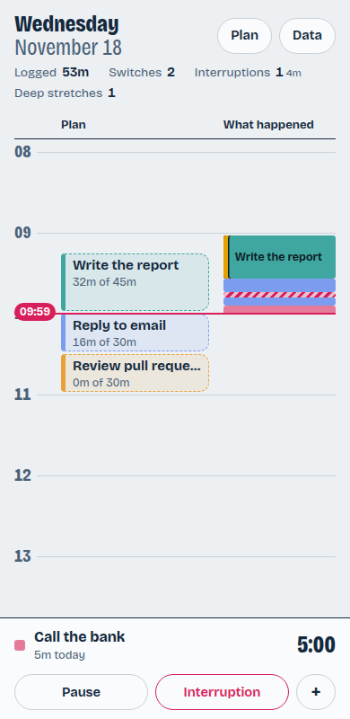

# Time-table

Plan the day, then log where it actually goes, one tap at a time. The plan and
what happened sit side by side on the same timeline, so drift is visible
without opening a report.

**Open it:** https://luis-serrano-l.github.io/time-table/

It is a web app that installs like a native one (a PWA), works offline, and
keeps everything on your device. There is no account and no server.

<p>
  
  
</p>

## The idea

Measuring your time should be something you choose to do, not something done
to you. Nothing here is tracked automatically: every entry is a tap you made.
The job of the app is to make that tap cost nothing.

The idea comes from [Singla](https://singla.day/). This is an independent
take on it, built from scratch around one change: the day is a timetable, and
planning, logging and looking back all happen on it.

## How to use it

| You want to | Do this |
|---|---|
| Plan the day | **Plan**, add tasks in the order you mean to do them, set a size for each. They are laid out end to end from the start time. |
| Start working | Tap a planned block. |
| Switch task | Tap another block. The first one stops by itself: only one thing runs at a time. |
| Pause | Tap the running block again, or **Pause**. |
| Log an interruption | **Interruption**. The task you were on is set aside; **Back to work** resumes it. |
| Do something unplanned | **+**, type a name, and it is already running. |
| Finish a task | The check mark in the plan. |

On the timeline, a dashed outline is a planned block and a solid bar is time
you logged. A hatched bar is an interruption. A gold edge marks a deep
stretch: 25 minutes or more on one task without a break. The header counts
logged time, task switches, interruptions and deep stretches for the day.

### Install it

- **Android / desktop Chrome or Edge:** open the link, then *Install app* in the browser menu.
- **iPhone / iPad:** open the link in Safari, then *Share → Add to Home Screen*.

## Your data

- The log is stored in the browser, on the device, and never leaves it.
- **Clearing the browser's site data erases it.** Use **Data → Export backup**
  now and then. The file is plain JSON.
- **Import backup** merges a file into what is already there, so it is also
  how you move to another device. Importing the same file twice changes
  nothing.
- Data belongs to the address the app is served from. If you host your own
  copy at a different address, export from one and import into the other.

## How it works

The log is an append-only list of events (task added, plan set, started,
stopped, interruption started and ended). Everything on screen is computed
from it. That makes a running timer just "started at this moment", so it
survives the app being closed, and it makes a backup one file.

```
src/log/     event types and the pure functions that turn events into the day
src/store/   IndexedDB persistence, export, import, merge
src/ui/      timeline, plan, dock, data dialog
src/pwa/     service worker registration and the "new version" prompt
e2e/         browser check of the whole flow against the production build
```

Vite, TypeScript and React. No backend, no analytics, no network requests
after the first load.

## Develop

```sh
npm install
npm run dev        # local server with reload
npm test           # unit tests for the log and backups
npm run build      # type-check and production build into dist/
npm run e2e        # browser check of the build (needs Chrome installed)
```

`node scripts/icons.mjs` redraws the PNG app icons.

## Host your own copy

The build uses relative paths, so `dist/` works from any folder on any static
host. For GitHub Pages: fork, then *Settings → Pages → Source: GitHub
Actions*. The included workflow tests, builds and publishes on every push to
`main`.

## Roadmap

- [x] Plan and log on one timeline, interruptions, export and import, offline
- [ ] Evening review, unfinished tasks roll over, fill gaps after the fact, catch a forgotten timer
- [ ] Insights: best hours of the day, how far estimates are off, interruption patterns, trends
- [ ] Icon badge and notification buttons while a timer runs, keyboard shortcuts, automatic backups

## License

[MIT](LICENSE)
