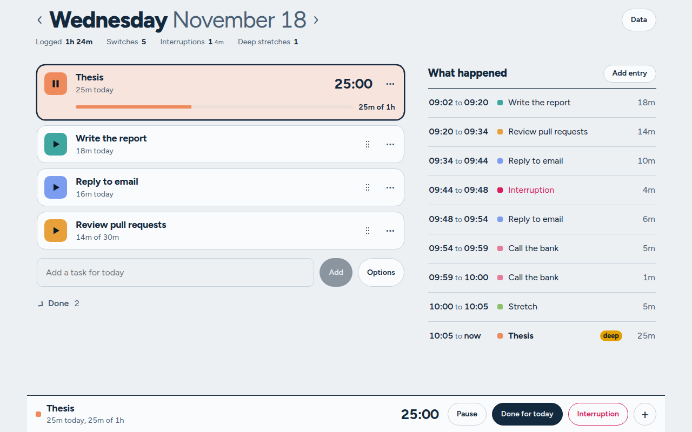

# Time-table

Put tasks on a day, tap one to start it, and the app writes down when you
did it. You say what belongs to the day, never at what time: the clock only
records what actually happened.

**Open it:** https://luis-serrano-l.github.io/time-table/

It is a web app that installs like a native one (a PWA), works offline, and
keeps everything on your device. There is no account and no server.

<p>
  
  
</p>

## The idea

Measuring your time should be something you choose to do, not something done
to you. Nothing here is tracked automatically: every entry is a tap you made.
The job of the app is to make that tap cost nothing.

The idea comes from [Singla](https://singla.day/). This is an independent
take on it, built from scratch around one screen: the day's tasks, and under
them the timetable that writes itself as you work.

## How to use it

| You want to | Do this |
|---|---|
| Put a task on the day | Type its name under the tasks and press **Add**. A name is all it needs. |
| Start working | Tap the task. The time is recorded from that moment. |
| Switch task | Tap another one. The first stops by itself: only one thing runs at a time. |
| Pause | Tap the running task again, or **Pause**. |
| Finish | **Finish**, next to Pause. The timer stops and the task moves under **Done**. |
| Log an interruption | **Interruption**, shown while a task is running. The task you were on is set aside; **Back to work** resumes it. |
| Start something new right now | **+**, type a name, and it is on today and already running. |
| Change the order | Drag a task by its grip, or focus the grip and use the arrow keys. |
| Plan another day | The arrows beside the date. A day to come can be filled but nothing on it can be started; a day gone by shows what was on it and what was logged. |
| Give a task an estimate | **Options** when adding, or the three dots on the task. It then shows "12m of 30m". |
| Repeat a task | In the same place, choose the days. It comes up on those days by itself, and **Done for today** ends it for that day only. |
| Work off a project | **Options**, tick *It is a project*, and give it a total of hours. Put it on the days you work on it, or let it repeat. Only time you log uses up the hours. When they run out, **Finish project** or **Add time**. |
| Keep yourself on a task | The three dots, then tick **Focus**. While it runs it fills the screen, the screen stays on, and the only ways out are **Pause**, **Finish** and **Interruption**. A web app cannot stop you leaving, so it counts it: time away from the app is logged as *Left the app*, an interruption. Away for more than an hour and the task is stopped at the moment you left. For a hard lock, add your phone's own: *App pinning* on Android, *Guided Access* on iPhone. |
| Take a task off the day | The three dots, then **Take off today**. It waits under **Not on today**. |
| Correct the log | Tap an entry under **What happened** to change when it started or ended, or delete it. **Add entry** writes in work you forgot to time. Entries cannot overlap. |
| Take something back | **Undo**, shown for a few seconds after you delete, take off or finish. |

A task you did not finish is on today the next morning, marked with the day it
came from. Repeating tasks and projects are not carried: they come up on their
own days, and wait under **Not on today** in between.

If a timer runs far past the task's estimate, or is still running when you
come back after an hour or more, the app asks whether you are still on it.
You can say when the work really ended. It never stops a timer by itself.

In the log, a "deep" mark is 25 minutes or more on one task without a break.
The header counts logged time, task switches, interruptions and deep stretches
for the day.

### Install it

- **Android / desktop Chrome or Edge:** open the link, then *Install app* in the browser menu.
- **iPhone / iPad:** open the link in Safari, then *Share → Add to Home Screen*.

## Your data

- The log is stored in the browser, on the device, and never leaves it.
- **Clearing the browser's site data erases it.** Use **Data → Export backup**
  now and then. The file is plain JSON.
- **Import backup** merges a file into what is already there, so it is also
  how you move to another device. Importing the same file twice changes
  nothing.
- Data belongs to the address the app is served from. If you host your own
  copy at a different address, export from one and import into the other.

## How it works

The log is an append-only list of events (task added, day's tasks set,
started, stopped, interruption started and ended, repeat rule set, entry
corrected, and so on).
Everything on screen is computed from it. That makes a running timer just
"started at this moment", so it survives the app being closed, and it makes
a backup one file. A repeating task is a rule, not a row per day: its
occurrences are worked out when a day is shown, so merging two devices never
doubles them. A task carried over from an earlier day is worked out the same
way. Undo, and a correction to the log, add entries that reverse or amend a
change; nothing is removed.

```
src/log/     event types and the pure functions that turn events into the day
src/store/   IndexedDB persistence, export, import, merge
src/ui/      task cards, log, dock, dialogs
src/pwa/     service worker registration and the "new version" prompt
e2e/         browser check of the whole flow against the production build
```

Vite, TypeScript and React. No backend, no analytics, no network requests
after the first load.

## Develop

```sh
npm install
npm run dev        # local server with reload
npm test           # unit tests for the log and backups
npm run build      # type-check and production build into dist/
npm run e2e        # browser check of the build (needs Chrome installed)
```

`node scripts/icons.mjs` redraws the PNG app icons.

## Host your own copy

The build uses relative paths, so `dist/` works from any folder on any static
host. For GitHub Pages: fork, then *Settings → Pages → Source: GitHub
Actions*. The included workflow tests, builds and publishes on every push to
`main`.

## Roadmap

- [x] Plan and log on one timeline, interruptions, export and import, offline
- [x] Tasks from 5 minutes, pinned times, other days, repeating tasks, projects with a total of hours
- [x] Undo, unfinished tasks roll over, catch a forgotten timer
- [x] Tasks belong to a day, not a time: tap to start, drag to reorder, correct the log by hand
- [ ] Evening review
- [ ] Insights: best hours of the day, how far estimates are off, interruption patterns, trends
- [ ] Icon badge and notification buttons while a timer runs, keyboard shortcuts, automatic backups

## License

[MIT](LICENSE)
